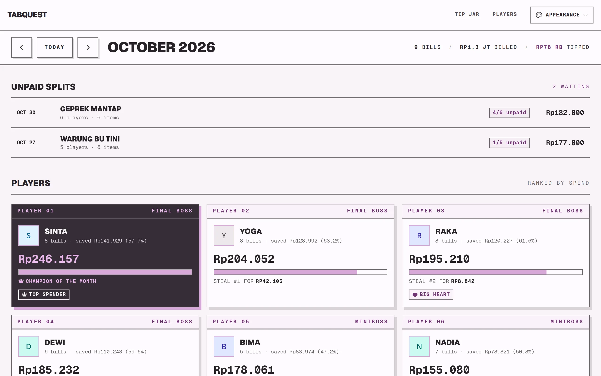
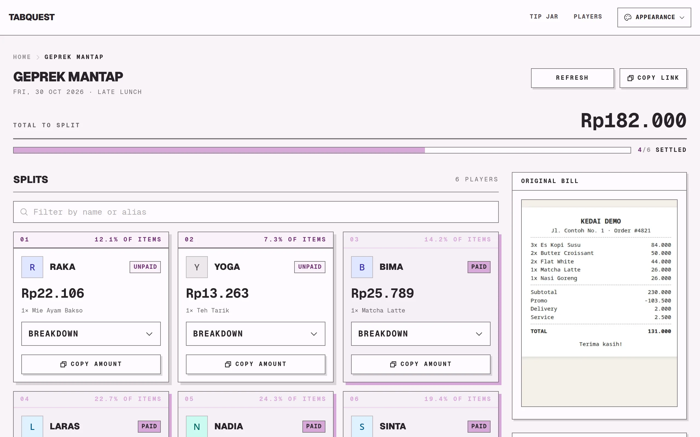
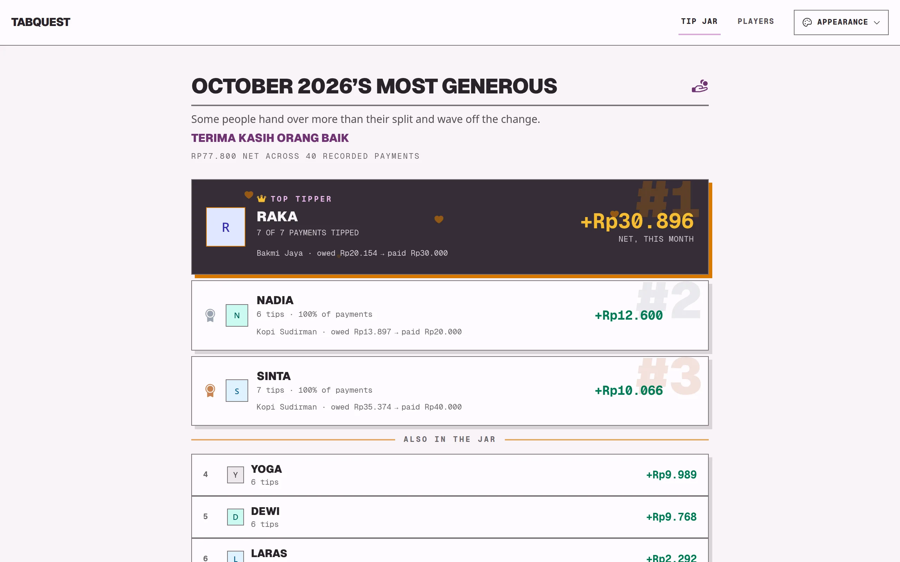
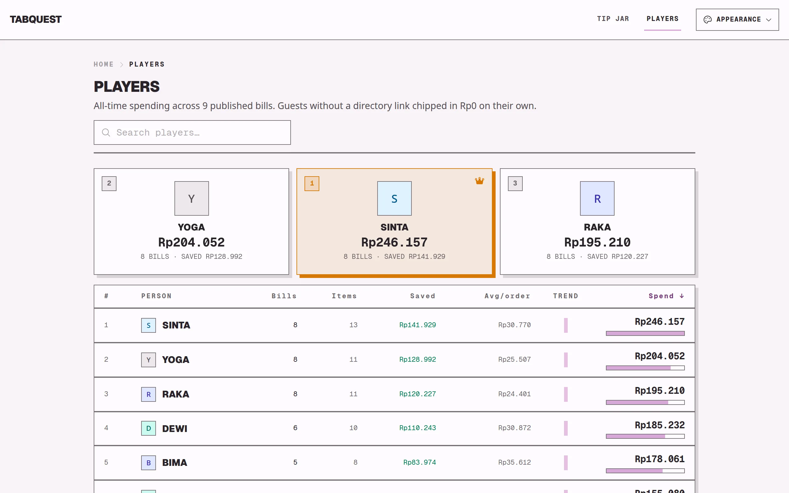
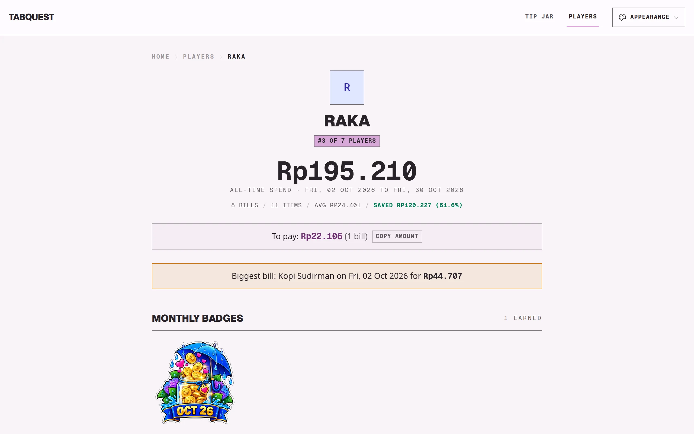
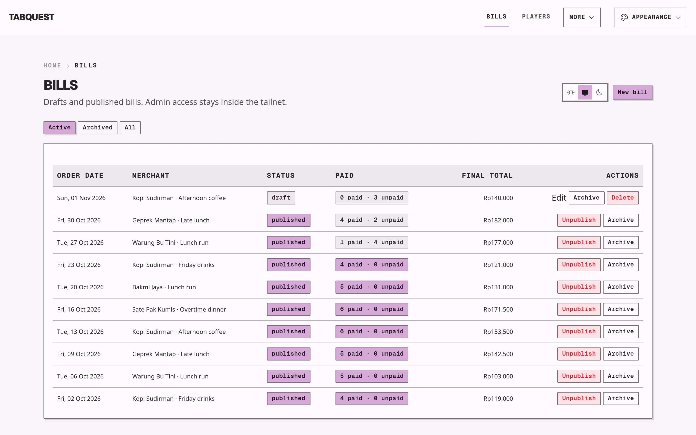
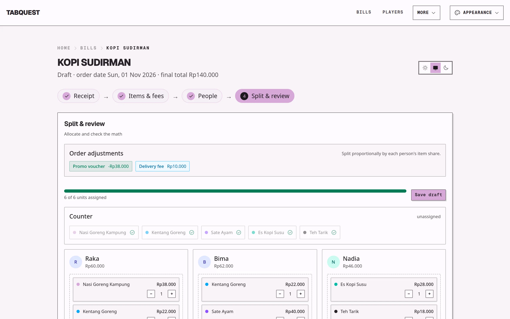

# Tabquest

A bill-splitting app for office group orders. It divides each receipt among the
people who ordered and turns paying up into a game, with monthly spending and
tip leaderboards and player badges.

Built with TanStack Start, React, TypeScript, shadcn/ui, Drizzle, and libSQL.
See `deploy/README.md` for hosting and `CONTEXT.md` for the domain language.

## Screenshots

All names, receipts, and amounts below are demo data.



<table>
  <tr>
    <td width="50%"><br><sub><b>Bill</b>: each player's split next to the receipt</sub></td>
    <td width="50%"><br><sub><b>Tip jar</b>: who rounded up this month</sub></td>
  </tr>
  <tr>
    <td><br><sub><b>Players</b>: all-time spending leaderboard</sub></td>
    <td><br><sub><b>Profile</b>: stats, amount owed, and monthly badges</sub></td>
  </tr>
  <tr>
    <td><br><sub><b>Admin</b>: drafts, published bills, and who has paid</sub></td>
    <td><br><sub><b>Editor</b>: assign receipt items to players</sub></td>
  </tr>
</table>

## Code checks

Run `just typecheck` for TypeScript 7 and `just lint` for Oxlint. Oxlint uses
`oxlint-tsgolint` for type-aware checks, including deprecated API usages.
Prettier still handles formatting through `just format`.

The Oxlint config preserves 65 supported rules from the previous ESLint config.
It also checks deprecated APIs. Four previous rules have no native equivalent:
type-parameter naming, preferring `node:` import prefixes, comment spacing, and
legacy octal syntax. Generated routes, static assets, and build output remain
outside lint checks.

## Adding components

To add components to your app, run the following command:

```bash
npx shadcn@latest add button
```

This will place the ui components in the `components` directory.

## Using components

To use the components in your app, import them as follows:

```tsx
import { Button } from "@/components/ui/button"
```
